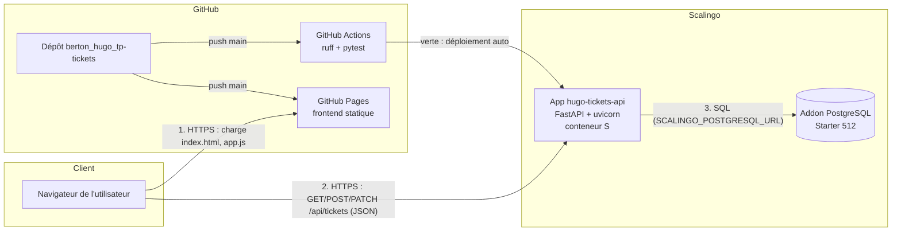

# Schéma d'architecture

## Les trois tiers

| Tier | Rôle | Techno | Hébergement |
|---|---|---|---|
| Présentation (frontend) | affiche les tickets, le formulaire et les statuts | HTML, CSS, JavaScript `fetch` | GitHub Pages (HTTPS, gratuit) |
| Logique métier (backend) | expose l'API REST, valide les données, seul à accéder à la base | Python 3.12, FastAPI, psycopg 3 | Scalingo, conteneur S |
| Données | stockage persistant de la table `tickets` | PostgreSQL 16 | addon PostgreSQL Scalingo |

## Pourquoi ces choix

- **Frontend statique sur GitHub Pages** : pas de build, déploiement à chaque push, HTTPS fourni, gratuit. Le frontend ne contient aucun secret, seulement l'URL publique de l'API.
- **API sur Scalingo** : PaaS européen avec le voucher Ynov, même plateforme que le TP précédent, logs et rollback en ligne de commande, déploiement automatique depuis GitHub qui attend la CI.
- **PostgreSQL en addon Scalingo** : la base est dans la même région que l'API (latence faible), l'URL de connexion est injectée automatiquement dans `SCALINGO_POSTGRESQL_URL`, donc jamais copiée à la main ni commitée.
- **Le conteneur est éphémère** : aucune donnée n'est écrite sur le disque, tout va dans PostgreSQL (F4).

## Sécurité

- Les identifiants de la base restent côté API (variable d'environnement Scalingo), le navigateur ne voit jamais la base.
- CORS : l'API n'accepte que l'origine du frontend (`CORS_ORIGINS`).
- Validation des entrées par Pydantic + contrainte `CHECK` sur les statuts en base.
- Requêtes SQL paramétrées (pas de concaténation), donc pas d'injection SQL.
- Tout est servi en HTTPS.
